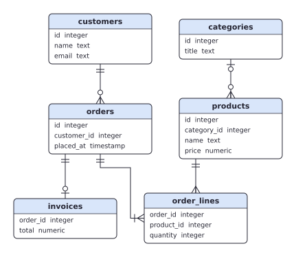
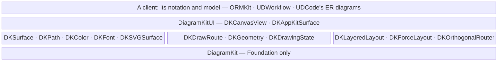
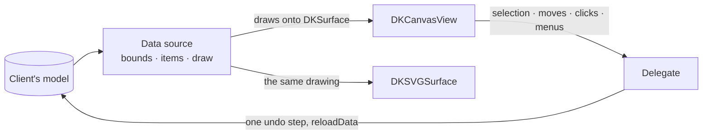

# DiagramKit

[](https://github.com/ashalkhakov/DiagramKit/actions/workflows/build.yml)

The machinery diagram editors share, in Objective-C, for **macOS, Linux and
Windows (GNUstep)**: drawing through a surface (AppKit or SVG), edge ends
from arrowheads to crow's feet, layered and force-directed layouts,
orthogonal routing, and a canvas that zooms, selects, moves, pans, exports
and prints. A client keeps its own notation and its own model; DiagramKit
has the rest. It is what ORMKit's ORM2 designer, UDWorkflow's process
designer and UDCode's entity-relationship diagrams have in common, taken
out of them.



*A schema laid out in layers, its foreign keys routed at right angles and
ended in crow's feet, drawn as SVG: the tests' example client
([`Tests/DKExampleDiagram.m`](Tests/DKExampleDiagram.m)).*

## Get it

Download from [Releases](https://github.com/ashalkhakov/DiagramKit/releases/latest):

| Platform | Download | Contains |
|---|---|---|
| macOS 12+ | `diagramkit-*-apple.zip` | `DiagramKit.xcframework`, `DiagramKitUI.xcframework` (universal) |
| Linux x86_64, aarch64 | `diagramkit-*-ubuntu22.04-*.tar.xz` | Both frameworks, for the GNUstep stack in `/opt/gnustep` |
| Windows x64 | `diagramkit-*-windows-clang64-x86_64.tar.xz` | Both frameworks, for the GNUstep stack in `C:\GNUstep` (MSYS2 CLANG64) |

A repository built with [gnustep-release-actions](https://github.com/ashalkhakov/gnustep-release-actions)
asks for it in its `.github/pins.env` (`DIAGRAMKIT_VERSION=<version>`), and
`scripts/deps.sh` fetches it. Every push also uploads unsigned builds to its
[Actions run](https://github.com/ashalkhakov/DiagramKit/actions).

Build from source:

    # macOS: open DiagramKit.xcodeproj; or
    make -f Makefile.apple            # the XCFrameworks, in build/apple
    make -f Makefile.apple check
    # Linux and Windows (MSYS2), with the GNUstep stack from gnustep-patches
    make && make check
    make install DESTDIR=<dir>

## What works

- **Drawing through a surface** (`DKSurface`): paths (lines, cubic curves,
  rectangles, rounded rectangles, ovals), fills, strokes solid or dashed,
  text set at a point or wrapped in a rectangle, in flipped diagram points.
  `DKAppKitSurface` draws into a view; `DKSVGSurface` writes a standalone
  SVG document with Foundation alone, estimating text widths.
- **Edge ends** (`DKDrawRoute`): arrows filled and open, UML's triangle and
  diamonds, and crow's feet (IE notation) — one, zero or one, many, one or
  many, zero or many — pointing along the route's end segments, the line
  stopped short of hollow marks.
- **Layouts**: layered (Sugiyama), left to right or top to bottom, cycles
  broken, long edges kept straight through placeholders, crossings reduced
  (`DKLayeredLayout`); force-directed, deterministic, with nodes fixed in
  place if need be (`DKForceLayout`); a free spot for a new shape near where
  it belongs (`DKFreeSpotNear`).
- **Routing** (`DKOrthogonalRouter`): right-angled routes from edge to
  edge, through as few other shapes as can be, by the sides a client allows;
  and a route kept, its bends slid along, when one of its ends moves.
- **The canvas** (`DKCanvasView`): drawn by a data source, edited through a
  delegate; zoom by scaling its bounds (so every point it reports is a
  diagram point), click and band selection, drags shown as dashed outlines
  and committed once, Space-drag and middle-button panning, arrow-key
  nudges, autoscroll, ⌘-scroll zoom, double-click and context menus for the
  delegate, text edited in place; export to PDF, PNG and SVG, and printing.
- **Checked**: 57 tests, the canvas's driven by synthesized events, on
  macOS and on Linux (GNUstep); CI runs them on every push, on Windows too.

## Limitations

- **No notation**: entities, roles, gateways and the like are the client's
  to draw; DiagramKit has no shapes of its own beyond paths.
- **Edges are the client's**: the canvas hit-tests, selects and moves items
  the data source names, and a route is points; dragging an edge's bends or
  its ends to other shapes is the client's to do (UDWorkflow does it).
- **Layered layout**: parts of the graph not joined to each other share
  its layers, side by side across them; nodes with no edges at all stack in
  the first layer (a force layout suits a schema of many loose tables
  better).
- **SVG text** is measured by an estimate, so left-set text in an SVG may
  run a little short or long of what AppKit sets.
- **GNUstep**: the hovered item follows the window's mouse-moved events
  (gnustep-gui has no tracking areas), and there is no dark appearance.

## Architecture

Two frameworks: one Foundation only, so that a model library (ORMKit's)
can draw and lay out without AppKit; one for AppKit, macOS's and GNUstep's
alike.





A client's painter draws through `DKSurface` only, so the same code draws
the view, the SVG and the print. The canvas asks its data source for the
drawing's bounds, what is at a point or in a rectangle, an item's frame, and
to draw a rectangle of it in a `DKDrawingState` (the selection, the hovered
item, whether it is for print); it tells its delegate what the user did.

| Path | What |
|---|---|
| `DiagramKit/` | The Foundation framework: surfaces, paths, edge ends, geometry, layouts, routing |
| `DiagramKitUI/` | The AppKit framework: `DKAppKitSurface`, `DKCanvasView`; `DiagramKitUICompat.h`, AppKit's newer names on GNUstep |
| `Tests/` | XCTests for both, and the example client (`DKExampleDiagram`) |
| `scripts/gnustep.make` | What the GNUstep makefiles share (builds out of the tree, in `build/gnustep`) |
| `DiagramKit.xcodeproj` · `GNUmakefile`s · `Makefile.apple` | The builds, Xcode's and GNUstep's; `make check` on both |

### A client, in short

```objc
@interface SchemaView : NSObject <DKCanvasDataSource, DKCanvasDelegate>
@end

@implementation SchemaView
- (NSRect)diagramBoundsForCanvas:(DKCanvasView *)canvas { return self.bounds; }
- (void)canvas:(DKCanvasView *)canvas drawInRect:(NSRect)rect
       surface:(id<DKSurface>)surface state:(DKDrawingState *)state
{
	for (Reference *r in self.references) {
		NSArray *route = [DKOrthogonalRouter routeFrom:[self frameOf:r.child] to:[self frameOf:r.parent]
		                                      avoiding:[self framesBut:r]];
		DKDrawRoute(surface, route, ink, 1, NO, DKEdgeEndCrowFootZeroOrMany, DKEdgeEndCrowFootOne);
	}
	for (Table *t in self.tables) {
		[surface strokePath:[DKPath pathWithRoundedRect:[self frameOf:t] radius:5]
		              color:[state showsSelected:t.name] ? DKColorSelection() : ink width:1 dashed:NO];
		/* ... its name and columns, with -drawText:at:font:color:centered: */
	}
}
- (id)canvas:(DKCanvasView *)canvas itemAtPoint:(NSPoint)point { /* the table there */ }
- (NSArray *)canvas:(DKCanvasView *)canvas itemsInRect:(NSRect)rect { /* the tables it touches */ }
- (NSRect)canvas:(DKCanvasView *)canvas frameOfItem:(id)item { return [self frameOf:item]; }
- (void)canvas:(DKCanvasView *)canvas moveItems:(NSArray *)items by:(NSSize)delta
{
	/* moved in the model, as one undo step */
	[canvas reloadData];
}
@end
```

Laid out first with `DKLayeredLayout` (`direction = DKLayoutTopToBottom`,
a node per table, an edge from each referenced table to the one referring
to it), whose `-layout` gives each table's frame.

## License

[MIT](LICENSE). DiagramKit relicenses its author's own code from ORMKit and
UDWorkflow.
